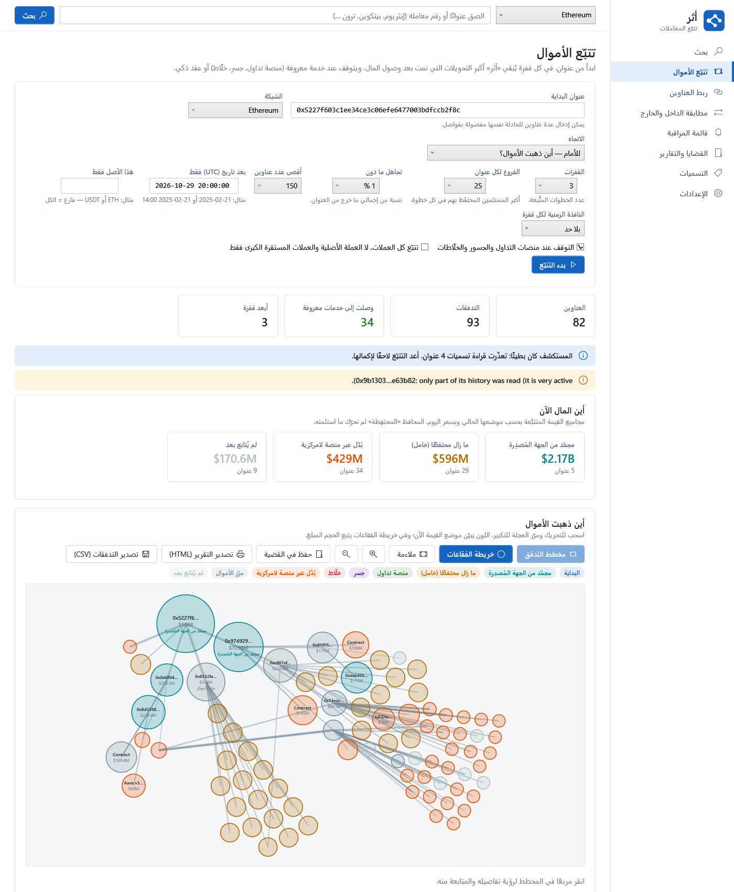
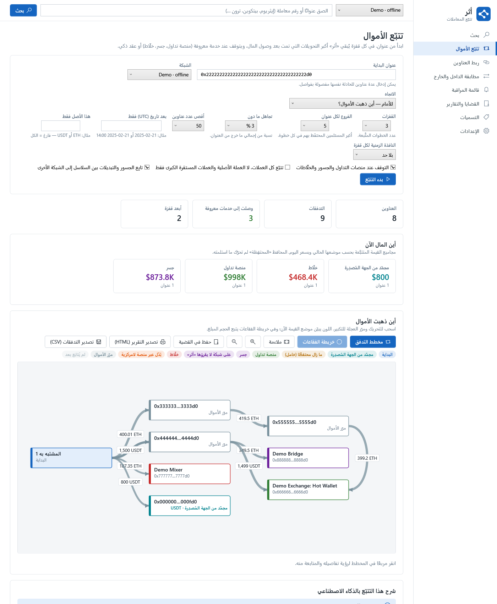
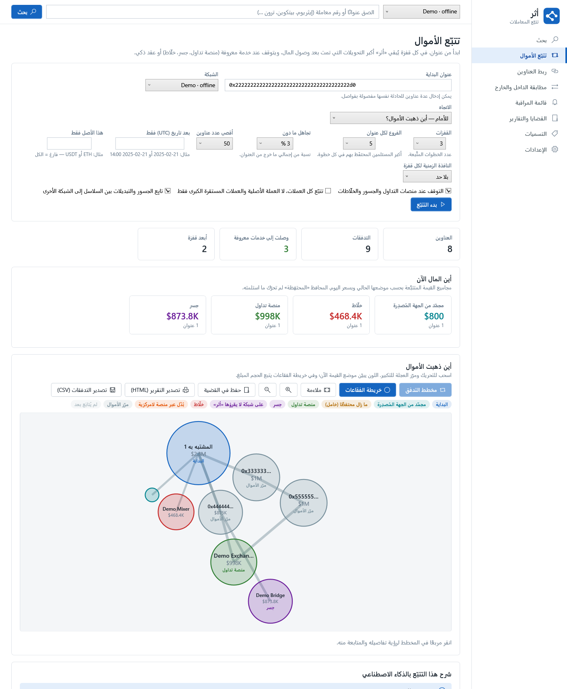
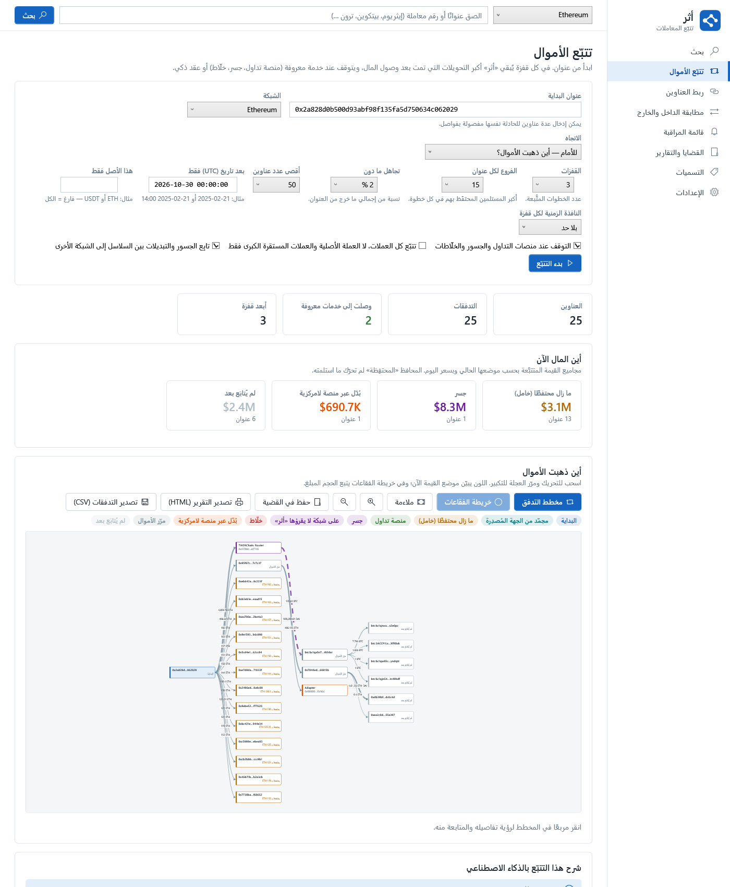
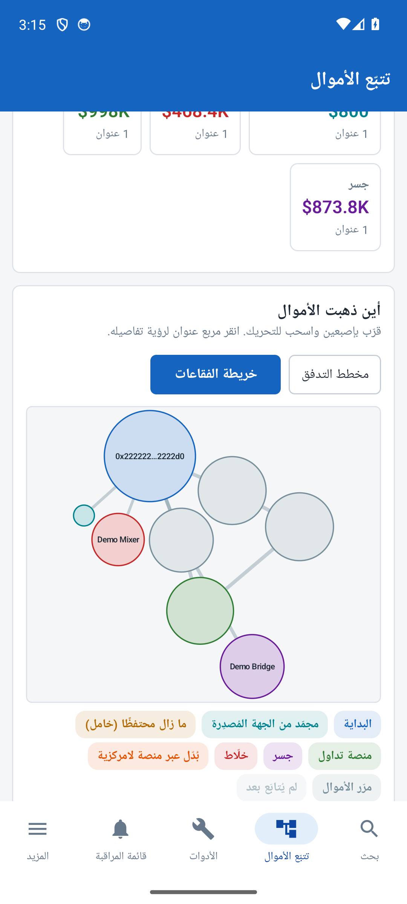

# Athar · أثر

**Blockchain transaction tracing for Windows and Android, in Arabic and English.**
Paste an address or a transaction hash; Athar reads public explorer data, explains what it sees and follows the money hop by hop, across bridges and onto other networks, until it reaches an exchange, a mixer, a frozen wallet or a wallet that is still holding it.

Athar only reads public data. It never asks for a wallet, a seed phrase or a private key, and it cannot move funds.

أثر تطبيق لتتبّع معاملات البلوكشين على ويندوز وأندرويد بالعربية والإنجليزية: يتتبّع الأموال قفزة بعد قفزة وعبر الجسور بين الشبكات، ويبيّن أين استقرّت: منصة تداول، خلّاط، محفظة مجمّدة أو محفظة ما زالت تحتفظ بها.



## Download

Get `Athar.exe` (Windows, needs the .NET 9 Desktop Runtime) and `Athar-1.0.apk` (Android 8+) from the [Releases](../../releases) page.

## What it does

| Area | Details |
|---|---|
| Address profile | Balance, labels, first funding, counterparties, large outgoing transfers, test transactions, pass-through behaviour, activity by hour, the same address on other EVM networks |
| Fund tracing | Forward or backward, level by level, from one or several start addresses. The largest transfers made after the funds arrived are followed; anything above $100,000 is always kept, so an equal split into many wallets is not lost |
| Status of every address | Start · frozen by the issuer · still holding (dormant) · exchange · mixer · bridge · swapped on a DEX · passed on · not followed |
| Freeze check | USDT and USDC blacklists with the frozen balance (Ethereum), USDT blacklist (Tron) |
| Cross-chain | The other side of a bridge or cross-chain swap is looked up from the service itself (THORChain through Midgard, LI.FI, Relay) and the trace continues on the destination network |
| Mixers | Separate findings for funds received from a mixer and funds sent into one, with amounts and dates |
| Spam filter | Look-alike tokens (symbols imitating ETH or USDT), empty symbols and advertising tokens are set aside and reported |
| Views | Flow diagram and bubble map (size = value, colour = status), "where the money is now" totals |
| Link addresses | Direct transfers, shared counterparties and a common first funder among up to 12 addresses |
| Match in / out | Pairs deposits into a bridge or privacy tool with later payouts by amount and timing |
| Watchlist | Alerts when a watched address moves funds (Android: background check with a notification) |
| Cases & reports | Addresses, transactions, saved traces, summary and findings; printable HTML report with both diagrams; CSV export |
| AI analysis (optional) | Explains an address, a trace or a case through the Claude API with your own key |

## Networks

| Network | Key needed | Source |
|---|---|---|
| Ethereum | no | api.routescan.io, eth.blockscout.com |
| Bitcoin | no | mempool.space |
| Tron | no | api.trongrid.io |
| Optimism, zkSync Era, Scroll, Unichain, Celo | no | Blockscout |
| Avalanche C, Mantle | no | api.routescan.io |
| Base, Arbitrum, Polygon, BNB Chain | free Etherscan API key (Settings) | api.etherscan.io v2 |
| Demo · offline | no | invented scenario built into the app |

Relay's public lookup requires an API key since late November 2026; add one in Settings to follow Relay deposits. Without it the deposit contract is still recognised as a bridge.

## Screenshots

| Flow diagram | Bubble map |
|---|---|
|  |  |

| Cross-chain: Ethereum → THORChain → Bitcoin | Android |
|---|---|
|  |  |

The case screenshots use addresses published by investigators of the October 2026 exchange hot-wallet theft; all data shown is public on-chain data.

## Run

```
Athar.exe                               start the app (data is kept in AtharData next to the exe)
Athar.exe --selftest log.txt            offline self-tests
Athar.exe --selftest log.txt --live     adds tests against the live explorers
Athar.exe --probe <address> --chain eth --out <folder>
                                        headless run of the address page and trace, with screenshots and a text summary
                                        (environment: ATHAR_HOPS, ATHAR_BRANCH, ATHAR_NODES, ATHAR_SHARE, ATHAR_FROM)
Athar.exe --snap <folder> --lang ar|en  renders every page to PNG and lists untranslated strings
```

## Build

Windows (C#, WPF, .NET 9):

```
dotnet publish -c Release -r win-x64 --self-contained false -p:PublishSingleFile=true -o dist
```

Android (Kotlin, Jetpack Compose) in `android/`:

```
./gradlew assembleRelease
./gradlew testReleaseUnitTest -Dathar.live=1
```

Arabic strings live in `L.Ar.cs`; their keys are the English text.

## Limits

- A trace shows where value moved, not who owns an address. After the first hops an address may mix the traced funds with unrelated money.
- Labels come from explorers and a small built-in list and can be wrong; confirm them on the explorer before citing them.
- Heuristics (test transactions, matching, links, swap and bridge detection) give leads to verify, not proof.
- Circle CCTP is not resolved; Solana and the XRP Ledger are shown as destinations but not traced.
- Results are investigative leads. An address is not a person; report thefts to the exchange concerned and to the police.

## Author

Dr. Mohammed Tawfik · kmkhol01@gmail.com · ORCID [0009-0004-7622-5991](https://orcid.org/0009-0004-7622-5991)

MIT License
